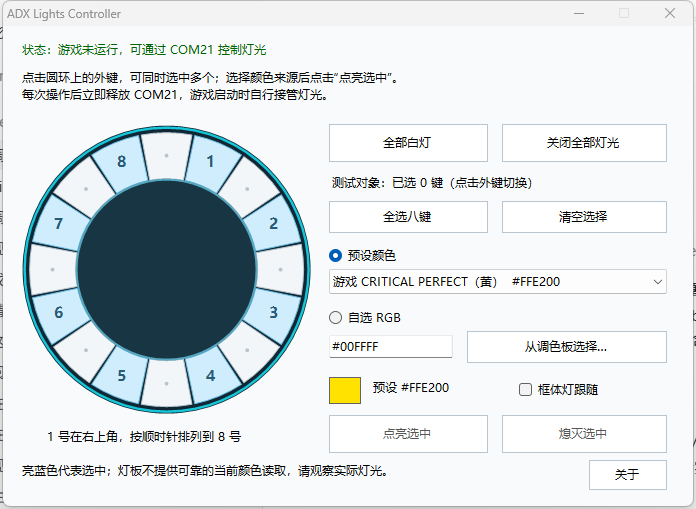

# ADX Lights Controller

一款用于ADX闲置灯光控制与测试的开源软件。它通过 COM21 控制八个外键和框体灯；游戏或 AMDaemon 运行时暂停操作，并在每次发送后释放串口。

## 功能

- 一键关闭全部灯光或点亮全部白灯。
- 在环形面板中同时选择多个外键，单独点亮或熄灭。
- 选择游戏颜色预设，或输入六位 RGB、使用调色板自选颜色。
- 可选让框体灯跟随所选颜色。

## 使用

1. 在 Windows 上解压发行包，双击 `ADX-Lights-Controller.exe`。需要 .NET Framework 4.8 和已配置为 COM21 的 ADX 灯光串口。
2. 点击环形面板中的一个或多个按键。亮蓝色表示选中；再次点击可取消。
3. 选择“预设颜色”或“自选 RGB”，确认色块旁显示的当前来源与色值，再点击“点亮选中”。未选中的按键保持原状态。
4. “熄灭选中”只关闭已选按键；“全部白灯”和“关闭全部灯光”始终作用于八键与框体灯。

输入 RGB 时会自动切换到自选模式；改变预设时会自动切回预设模式。RGB 格式错误时，“点亮选中”不可用。程序启动本身不会发送灯光命令。



## 构建

在 Windows PowerShell 中运行：

```powershell
.\build.ps1
```

脚本使用 Windows 的 .NET Framework C# 编译器，生成 `dist/ADX-Lights-Controller.exe` 并运行不访问串口的自检。无须额外 NuGet 包。

命令行 `--off` 和 `--white` 可分别关闭全部灯光、点亮全部白灯；`--self-test` 只执行程序检查，不操作硬件。

## 版本与作者

版本：v1.0.0  
作者：DeGuKe  
哔哩哔哩：[space.bilibili.com/15706430](https://space.bilibili.com/15706430)  
GitHub：[github.com/DeGuKe](https://github.com/DeGuKe)

## 许可证

本项目采用 [MIT License](LICENSE)。
